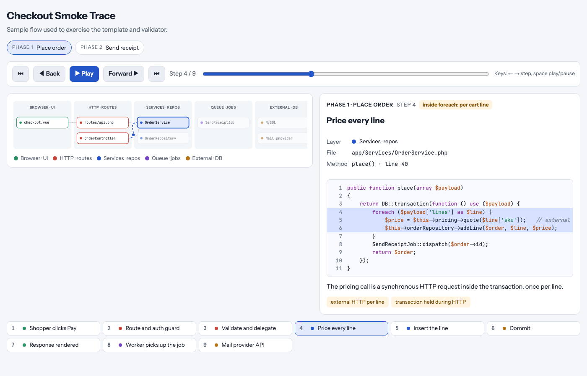
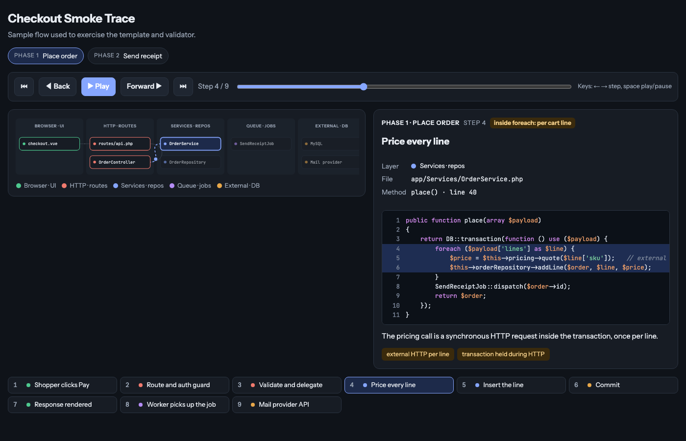
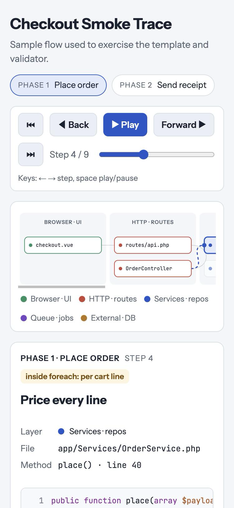

# flow-trace

A Claude Code skill that turns "how does this request work?" into an interactive, animated, step-through page: one hop per file, the real code with the executing lines highlighted, a plain-language note, and cost or risk tags, with Back, Forward, Play, a scrubber, phase chips and keyboard navigation.

It is built for the questions engineers actually ask: where does the time go, which hop breaks, what runs inside the loop, and what does a teammate need to read to understand this flow.



The same page follows the viewer's theme and stacks to one column on a phone. The data in these screenshots is a made-up checkout flow from `tests/build-smoke.js`, not a real codebase.

| Dark theme | Phone width |
|---|---|
|  |  |

## What you get

- A lane diagram (browser, HTTP, services, queue, external, or whatever fits the stack) that animates each hop from the previous file to the current one
- A detail panel per step: layer, file, method and line, syntax-highlighted code with the executing lines marked, a note, and load pills; pills prefixed with `!` render in a warning color
- Phases for the user-visible stages of the flow, a clickable step list, light and dark themes, and a phone-width layout
- A validator that checks the page script, every node, lane, phase and highlighted line, leftover placeholders, and, with `--root`, that every referenced file exists on disk

## Install

Clone this repository into a skills folder. The repo root is the skill, so the folder name becomes the skill name.

For one project, so everyone on that repo gets it:

```bash
git clone https://github.com/shibbirweb/flow-trace-skill .claude/skills/flow-trace
```

For your own account, in every project:

```bash
git clone https://github.com/shibbirweb/flow-trace-skill ~/.claude/skills/flow-trace
```

Or download the `.skill` file from the latest release and add it through the Claude app. Claude Code picks the skill up on the next session.

### Let your AI agent install it

Paste this into Claude Code, Codex, Cursor, Copilot or any similar agent:

```
Install the skill from https://github.com/shibbirweb/flow-trace-skill by following its INSTALL.md, then verify it.
```

`INSTALL.md` tells the agent where the skill goes for each harness, how to copy it, how to verify the install, and what to add when the harness has no skills directory. Ask in plain words ("visualize how the checkout request flows through the code", "trace the nightly import file by file", "make a click-through of the login flow") or invoke it as `/flow-trace`.

## How it works

1. The skill pins the entry point and end state, then splits the flow into two to four phases.
2. It picks a lane set from `references/lane-presets.md`, or from a `flow-trace-presets.md` file in your repo if you keep one.
3. For every hop it reads the file and records the path, method and line, a 5 to 40 line snippet, the lines to highlight, a note, and load pills.
4. It fills `assets/trace-template.html`, runs `scripts/validate_trace.js`, and publishes the page as an Artifact or saves it as a file.
5. The reply summarizes the phases and anything surprising found while reading the code.

## Project presets

Teams keep their own hop orders in a `flow-trace-presets.md` at the repo root or under `docs/`: which interceptor to show, which base job class every queue job extends, where the route table lives, which external systems sit on the last lane. The skill reads that file before the generic presets.

## Validate a page by hand

```bash
node scripts/validate_trace.js path/to/my-trace.html --root /path/to/repo
```

## Files

```
flow-trace/
├── SKILL.md                      instructions Claude follows
├── assets/trace-template.html    the page; only the data block is filled per trace
├── scripts/validate_trace.js     pre-publish checks
├── references/lane-presets.md    lane sets and hop orders for common stacks
└── evals/evals.json              example prompts and expectations for testing the skill
```

## License

MIT. See `LICENSE`.
